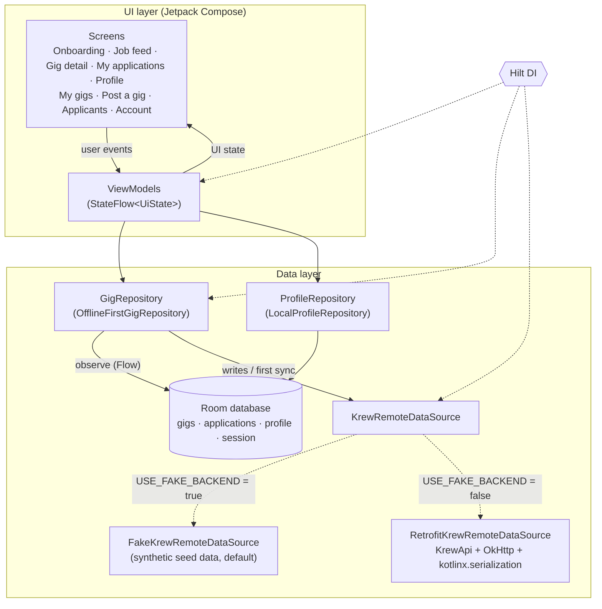

# Krew18

Krew18 is a native Android app for a travel and hospitality talent platform. It connects
hospitality and travel workers (chefs, bartenders, tour guides, housekeeping, front desk and
event staff) with employers (hotels, resorts, travel companies and event organisers) who need
people for short-term gigs.

> **Demo rebuild.** This repository is a demo rebuild of the Krew18 concept. It is **not** the
> original client codebase. All employers, people, gigs and pay rates in the app are synthetic
> sample data. There is no production backend, no real users and no usage metrics behind this
> project.

## Features

**Onboarding**
- Pick a role, **Talent** or **Employer**. The choice is stored locally and can be switched at
  any time from the Profile or Account tab.

**Talent**
- **Job feed** with search and filters for role, location (city), minimum hourly pay and dates
  (next 7 / 30 / 90 days). Gigs you have applied to are marked.
- **Gig detail** with pay, dates, openings, description and requirements.
- **Apply** with an optional short note. Your profile snapshot is attached to the application.
- **My applications** with live status (Applied, Shortlisted, Accepted, Not selected) and a
  status filter.
- **Profile**: name, headline, primary role, city, years of experience, experience summary,
  skills, languages, availability and whether you are open to travel.

**Employer**
- **My gigs**: your posted gigs with applicant counts.
- **Post a gig**: title, role, city, hourly rate, openings, date range (Material 3 date picker),
  description and requirements, with form validation.
- **Applicants**: review applicants per gig, then shortlist, accept or decline. Accepting is
  limited by the number of openings.

**General**
- Bottom navigation per role.
- Light and dark themes with a custom brand palette (lagoon teal, sunset coral, warm sand). The
  theme follows the system or can be set to Light or Dark in-app.
- Works fully offline: data comes from an in-app fake backend and is persisted with Room.

## Architecture

The app is a single module using MVVM and unidirectional data flow:

- **UI**: Jetpack Compose screens observe a `StateFlow<UiState>` from a Hilt `ViewModel`, and
  user actions go back to the ViewModel as method calls.
- **Repositories** (`GigRepository`, `ProfileRepository`) are the single entry point for data.
  `OfflineFirstGigRepository` treats Room as the source of truth: reads are `Flow`s from Room,
  and writes go to the backend first and are then stored in Room.
- **Remote**: `KrewRemoteDataSource` has two implementations:
  - `FakeKrewRemoteDataSource` (the default), an in-app fake backend seeded with synthetic data
    that simulates a little latency.
  - `RetrofitKrewRemoteDataSource`, which calls the `KrewApi` Retrofit interface (OkHttp +
    kotlinx.serialization). No server ships with this demo.



### Package layout

```
com.krew18.app
├── Krew18App.kt / MainActivity.kt   Hilt application and single activity
├── di/                              Hilt modules (clock, Room, Retrofit/OkHttp, backend choice, repositories)
├── domain/model/                    Plain Kotlin models and the job feed filter logic (GigFilter)
├── data/
│   ├── local/                       Room entities, DAOs, database
│   ├── remote/                      KrewApi (Retrofit), DTOs, remote data source
│   │   └── fake/                    Fake backend and synthetic seed data
│   ├── repository/                  GigRepository, ProfileRepository
│   └── Mappers.kt                   DTO <-> entity <-> domain mapping
└── ui/
    ├── theme/                       Brand colours, typography, shapes, light/dark schemes
    ├── navigation/                  Routes and bottom-navigation destinations
    ├── components/                  Shared composables (gig card, status pill, empty state, ...)
    ├── onboarding/
    ├── talent/                      feed, detail, applications, profile
    └── employer/                    gigs, post, applicants, account
```

### Switching to a real backend

The backend is chosen in `app/build.gradle.kts`:

```kotlin
buildConfigField("boolean", "USE_FAKE_BACKEND", "true")
buildConfigField("String", "API_BASE_URL", "\"https://api.example.com/v1/\"")
```

Set `USE_FAKE_BACKEND` to `false` and point `API_BASE_URL` at a server that implements the
endpoints in `data/remote/KrewApi.kt`. The rest of the app does not change.

## Tech stack

| Area | Library | Version |
| --- | --- | --- |
| Language | Kotlin | 2.0.21 |
| Build | Android Gradle Plugin / Gradle (Kotlin DSL, version catalog) | 8.7.3 / 8.11.1 |
| UI | Jetpack Compose (BOM), Material 3, Material icons extended | 2024.12.01 |
| Navigation | Navigation Compose | 2.8.5 |
| Architecture | AndroidX Lifecycle ViewModel + StateFlow | 2.8.7 |
| DI | Hilt (Dagger) + hilt-navigation-compose | 2.52 / 1.2.0 |
| Persistence | Room (KSP) | 2.6.1 |
| Networking | Retrofit, OkHttp, kotlinx.serialization | 2.11.0 / 4.12.0 / 1.7.3 |
| Async | Kotlin Coroutines + Flow | 1.9.0 |
| Java time on API 24+ | Core library desugaring | 2.1.3 |
| Tests | JUnit 4, kotlinx-coroutines-test, Turbine | 4.13.2 / 1.9.0 / 1.2.0 |

SDK levels: `minSdk 24`, `targetSdk 35`, `compileSdk 35`. Java/Kotlin bytecode target: 17.

All versions are declared in [`gradle/libs.versions.toml`](gradle/libs.versions.toml).

## Building and running

### Android Studio

1. Install a recent Android Studio (Ladybug 2024.2 or newer works with AGP 8.7) with the
   Android SDK Platform 35.
2. **File > Open** and select this folder. Android Studio creates `local.properties` with your
   SDK path and syncs Gradle.
3. Select the `app` run configuration and run it on an emulator or a device (Android 7.0 / API 24
   or newer).

On first launch the app copies the synthetic seed data into its local Room database. To start
over, clear the app's storage from system settings.

### Command line

JDK 17 or newer is needed, and the Android SDK must be found through `ANDROID_HOME` or
`local.properties` (`sdk.dir=...`).

```bash
./gradlew assembleDebug        # build the debug APK (app/build/outputs/apk/debug/)
./gradlew testDebugUnitTest    # run the JVM unit tests
./gradlew installDebug         # install on a connected device or emulator
```

On Windows use `gradlew.bat` instead of `./gradlew`.

## Tests

The unit tests in `app/src/test` run on the JVM and do not need a device:

- `OfflineFirstGigRepositoryTest`: first sync, ordering, applying (including duplicate
  protection), posting gigs, status updates and failure handling.
- `LocalProfileRepositoryTest`: role, theme and profile persistence.
- `GigFilterTest`: role, city, pay, date window and search matching.
- ViewModel tests for app state and onboarding, job feed, gig detail and applying, my
  applications, profile editing, posting a gig and managing applicants.

The tests use the real repositories wired to in-memory DAO fakes and the fake backend, with a
fixed `Clock` so date-based logic is deterministic.

## Licence

No licence file is included yet. Add one before reusing this code.
